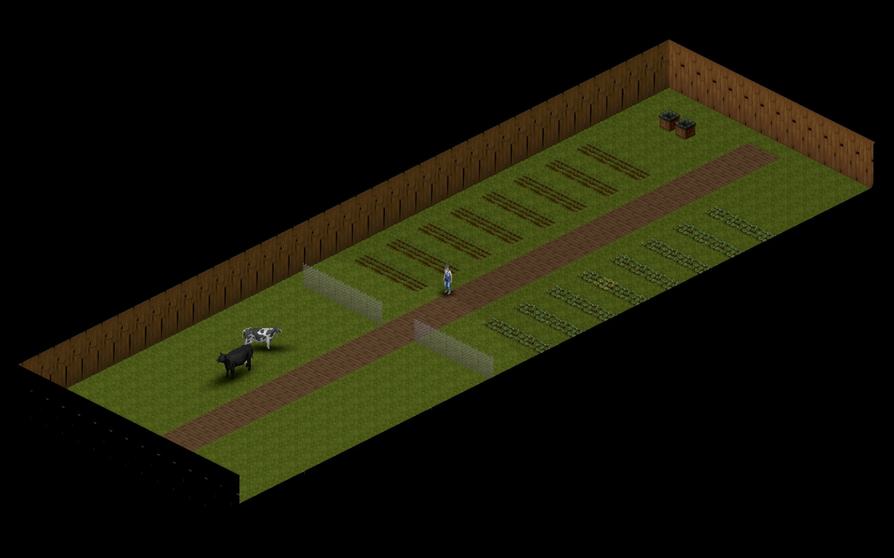

# Farm Trailer

The cows wanted a garden.

*No human has ever opened this folder. Good luck!*

A Project Zomboid **Build 42.21** add-on for Project RV Interior and KI5's Trailers!.
KI5's livestock trailer gets a persistent **12 × 40 outdoor farm**, with permanent wooden
walls, no roof and two empty 400 L water collectors. Crops, animals and corpses stay
when you leave. Normal weather, hunger, disease and decay apply.

[Subscribe on Steam Workshop](https://steamcommunity.com/sharedfiles/filedetails/?id=3826535986)



## Play

Enable Farm Trailer and all three dependencies:

- [Project RV Interior](https://steamcommunity.com/sharedfiles/filedetails/?id=3543229299)
- [Trailers!](https://steamcommunity.com/sharedfiles/filedetails/?id=3330403100)
- [that DAMN Library](https://steamcommunity.com/sharedfiles/filedetails/?id=3171167894)

Use the current Project RV Interior release with its entry/exit hooks (October 26, 2026 or later).
Load `map_distanciado` before `Muldraugh, KY` in the world's map list.
Stand beside an unlocked KI5 livestock trailer and enter through its vehicle radial.
Right-click the ground inside to leave. Each trailer receives its own plot, up to 38.
Only KI5's livestock trailer (`Base.TrailerKI5livestock`) uses this farm.
If the entry option is missing, confirm the server and every client enabled
`FarmTrailer` and all dependencies, then restart after an update.
New plots contain soil, perimeter walls and two collectors. The original perimeter
blocks climbing, normal attacks, fire and sledgehammers. An invisible one-tile
border outside the walls blocks movement. The photos show a staged
farm with crops, pens and livestock added for the demo.

For a local install, copy `FarmTrailer` to `~/Zomboid/mods/`, or run
`python3 install.py`. The installer verifies every file and refuses to overwrite a
different local installation. It never edits Workshop subscriptions or saves.

### Water

Enter once to create the farm. Rain and normal containers can fill the collectors.
For a river or lake refill, carry a **Rubber Hose**, connect a tow vehicle with a
charged battery, and park within six tiles of the water. Choose **Fill farm tanks**
in the vehicle radial. It pumps 20 L per action, up to 800 L. Walk away to stop.
A full fill uses 20% battery charge. River water stays tainted. Water adds towing
weight. Destroyed collectors stay destroyed.

The vehicle radial shows the last measured water total, labelled **snapshot**.
Below 160 L, it shows **LOW**. Farm entry gives one low-water notice after the
collectors load. An unknown level says to enter the farm to check.

### Animals

The normal livestock compartment and the walk-in farm are separate. Loading an
animal into the trailer does not put it in the farm. Cows and chickens use the
same transfer controls.

**Into the farm:**

1. Load the animal into the exterior trailer with the normal livestock controls.
2. Open the vehicle radial and choose **Bring livestock into farm**.
3. Select the animal. You and that animal enter the farm.
4. Repeat for each animal. Set up normal livestock zones, pens, feed and water.

**Out of the farm:**

1. Stand close to the animal inside the farm.
2. Right-click nearby and choose **Bring [animal] out of farm**.
3. You and the animal return outside. The animal appears on the ground beside the
   trailer. It is not automatically loaded into the normal livestock compartment.

**Unload the normal compartment:** open the trailer's livestock panel, right-click
an animal's portrait and choose **Remove Animal**. It appears on the ground outside.
This does not move it into the farm.

The farm has no mod-imposed animal count limit. The exterior trailer holds 500
animal-size points, not 500 kg. Animals consume different amounts of that space.
Place an animal you already carry before you transfer another.

The server completes pickup before it requests the crossing. If a crossing fails,
the native animal carrier stays with the player. Enter the intended farm or use
normal native placement. Carriers from the first release without a destination ID
need manual native placement. The mod does not discard them.

### Multiplayer and limits

The server and every player need this item and its dependencies. Put `FarmTrailer`
after the dependencies in `Mods`. Add `3826535986`, `3543229299`, `3330403100` and
`3171167894` to `WorkshopItems`. Keep the RV Interior map in the map list.

- Tested on 42.21.0 with native crop growth, shoreline refills, cattle transfers and
  persistence across a full server restart. The isolated compatibility run used a
  recorded 83-mod server stack. **The author reports it working in live multiplayer.**
  That report does not certify every server setup.
- This reuses KI5's existing exterior model. It does not convert an interior already
  assigned to a trailer. Existing farm walls and fences upgrade in place. Conflicting player construction
  stays untouched, so modified boundaries can retain gaps.
  The safety update preserves old interior routing and handles farm occupants saved
  with the wrong room type by the first release. If that release assigned both an old
  room and a farm, both remain saved. Entry follows the trailer's saved type. No
  automatic migration or deletion resolves duplicate assignments.
- Exit clears live zombies only in the five-tile band outside the farm walls.
  Animals and corpses remain untouched, inside and outside.
- Do not combine add-ons that replace this trailer's interior registration or use
  its map band at y=12500. There are 38 plots. Back up your save.

## Source and checks

`FarmTrailer/42/` contains all six runtime files. Only that directory belongs in
the installed mod. This repository contains no game or dependency files.

The portable behaviour suite uses Python 3.12 and Lupa 2.6:

```sh
uv run --no-project --python 3.12 --with lupa==2.6 python tests/test_farm.py
```

The shared executor can run the same suite with `project-test --suite test`.
Native game tests and the original release evidence remain in the
[development harness](https://github.com/fbserg/etc/tree/main/mods/farm-trailer).
They need a licensed local game and installed dependencies. Portable tests do not
replace the native game checks.

This standalone repository is the home for future mod changes. The initial runtime
matches the Workshop release from the repository root commit `061f946` byte for byte.

## License and credits

The original add-on code and tools are available under the [MIT license](LICENSE).
Project Zomboid, dependency mods and their assets retain their owners' terms. They
are required separately and are not relicensed or bundled here. Screenshots show
in-game assets and are not part of the code license grant.

- **Mickey Knox / Project RV Interior** provides the map, room assignment and entry
  system. Registration follows the author's
  [integration example](https://github.com/M1ckeyKnox/B42-RV-Interior-Integration-Code).
- **KI5 / Trailers!** provides the vehicle model, towing and normal livestock UI.
- **The Indie Stone / Project Zomboid** provides farming, fluids, animals and saves.
- [Water Trailer B42.20 Fix](https://steamcommunity.com/sharedfiles/filedetails/?id=3776875714)
  and [Water Pipes](https://steamcommunity.com/sharedfiles/filedetails/?id=3546314080)
  informed the shoreline refill design. Neither is bundled or required.

## Shared source

This mod now lives in [fbserg/zomboid-mods](https://github.com/fbserg/zomboid-mods). The original repository remains intact. Use the [shared release playbook](../../docs/releasing.md). Existing Workshop IDs and runtime Lua stay unchanged.
